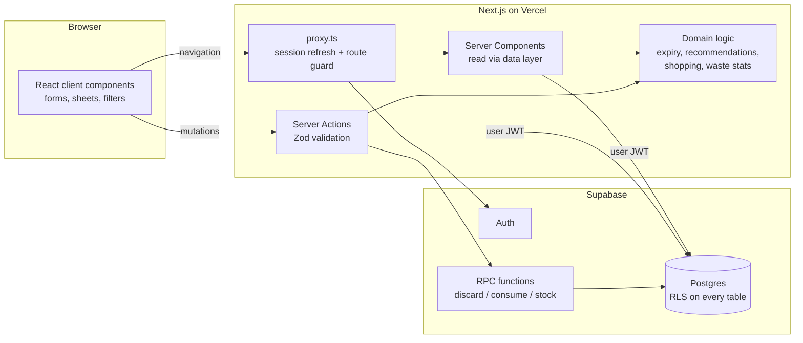

# Savora

Savora is a household food management app. It keeps track of the food in your fridge, freezer and pantry, shows what needs using first, suggests meals built around those items, and keeps a shopping list that knows what you already have. When something does get thrown away, a waste log records it so patterns become visible.

Built for the NOTAR Academy hackathon (theme: food waste at home).

- **Live app:** _deployment URL is added here once published_
- **Presentation:** [`submission/SAVORA-presentation.pdf`](submission/SAVORA-presentation.pdf)
- **Try it:** open the app and press **Explore the live demo**. It signs you in to a private, temporary kitchen filled with sample data. No email is needed.

## Features

| Area | What it does |
| --- | --- |
| Dashboard | Counts of items in stock, items to use soon and items past date; a seven-day expiry timeline; top meal suggestions; food-saving notes generated from your own data; a storage breakdown. |
| Inventory | Add, edit, delete, search, filter (category, storage, status) and sort (date, name, category, recently added). Filters live in the URL and run in the database. |
| Fast entry | Type a name and Savora fills in the category, storage, unit, a typical quantity and a suggested date from a catalog of about 90 foods. Quick date buttons (+3 days … +1 month) and "Save & add another" keep entry fast. The form always asks people to use the date on the package. |
| Expiry tracking | Three states: **Fresh**, **Use soon** (date within 3 days) and **Past date**. A dedicated Use soon page groups urgent items and suggests recipes that use them. |
| Meal suggestions | A rule-based engine ranks 24 curated recipes by how urgently their ingredients need using and how much you already have. Each suggestion lists matched and missing ingredients and explains why it was chosen. "I cooked this" updates the inventory; missing ingredients go to the shopping list in one tap. |
| Shopping list | Blocks duplicate entries (in the app and with a unique database index), warns when an item is already at home, groups items by category, and moves bought items into the inventory with a suggested date you can adjust. |
| Waste log | "Throw away" on any product records the quantity, reason, date and a pro-rated cost (only if a price was entered). Separate entries can be logged for untracked food. Statistics: items logged, logged value, this month versus last month, a weekly trend chart, categories and reasons. |
| Demo | One-click anonymous demo account seeded with sample data. Every sample row is stored with `is_demo = true`, tagged **Sample** in the UI and removable in one click. |

Savora makes no food-safety claims. "Past date" means the date someone entered has passed; it is a prompt to check the food, not a verdict.

## Tech stack

- **Next.js 16** (App Router, Server Components, Server Actions, `proxy.ts`), **React 19**, **TypeScript** in strict mode
- **Tailwind CSS 4** with a custom token set, **Lucide** icons, **Recharts** for the waste trend, **GSAP** for a few landing-page transitions (disabled under `prefers-reduced-motion`)
- **Supabase**: PostgreSQL, Auth (email/password and anonymous demo sessions), Row Level Security
- **Zod 4** for validation on every Server Action
- **Vitest** for domain logic, **Playwright** for the end-to-end smoke test

## Architecture



The code is split into layers so that business rules stay testable and independent of React and Supabase:

```
src/
  app/                 routes (landing, auth, /app/*)
  components/          UI, grouped by feature (inventory, meals, shopping, waste, ui)
  lib/
    domain/            pure TypeScript: dates, expiry, catalog, recipes,
                       recommend, shopping, waste, insights, demo data (+ tests)
    data/              server-only reads (session/viewer, queries)
    actions/           Server Actions: validate → authorise → write → revalidate
    supabase/          clients, proxy session handling, generated DB types
    validation.ts      Zod schemas shared by forms and actions
supabase/migrations/   SQL schema, RLS policies and RPC functions
scripts/e2e-smoke.mjs  Playwright end-to-end test
```

### Data model

| Table | Purpose | Notes |
| --- | --- | --- |
| `households` | A shared food space | Created automatically for every new user by a trigger on `auth.users`. |
| `household_members` | Links users to households | Composite primary key; ready for shared households. |
| `profiles` | Display name, active household, onboarding state | Users may update only `display_name` and `onboarded_at` (column-level grants). |
| `products` | Inventory | `expires_on date` (date-only), `quantity numeric(10,2)`, `price_cents integer`, enums for unit, category and storage, check constraints, indexes on `(household_id, expires_on)` and `(household_id, category)`. |
| `shopping_items` | Shopping list | Generated `name_key` column plus a partial unique index on open items to prevent duplicates. |
| `waste_records` | Discarded food | Reason enum, date, optional cost; indexed by `(household_id, discarded_on)`. |

### Security

- Row Level Security is enabled on every table. Policies allow access only to rows whose `household_id` belongs to the signed-in user (`my_household_ids()`, a `SECURITY DEFINER` helper with a fixed `search_path`).
- The anonymous Postgres role has no privileges on household tables.
- The app uses only the Supabase **publishable** key. No service-role or secret key exists in the codebase or in the deployment; every query runs as the signed-in user, so the database enforces authorisation.
- Multi-step writes (`discard_product`, `consume_product`, `stock_purchased_items`) are `SECURITY INVOKER` Postgres functions. They run in one transaction, lock the row they change, and still pass through RLS.
- Every Server Action validates its input with Zod, checks the session, and returns user-safe error messages. Database error details are logged on the server, not shown to users.
- Redirects after sign-in accept only relative `/app` paths.

### Dates and time zones

Expiry and purchase dates are calendar dates, stored as Postgres `date`. All date arithmetic works on whole UTC days in `lib/domain/dates.ts`. The browser's IANA time zone is stored in a cookie, and the server uses it to work out the viewer's local "today", so a product dated 8 November shows "1 day left" in Tashkent and in Los Angeles at the right moment for each. Tests cover month, year and daylight-saving boundaries.

### How meal suggestions work

1. Each inventory item is matched to a catalog ingredient by name ("Cherry tomatoes" → tomato, "Chicken stock" → stock). Longer aliases win, and on a tie the last word wins, because grocery names end with the main noun.
2. Items past their date are ignored.
3. For each recipe, every ingredient is matched to the most urgent product that fits (recipes can list alternatives, such as carrot, pepper or broccoli).
4. Score = urgency of matched items (4 points for ≤1 day, 3 for ≤3 days, 1.5 for ≤7 days, 0.5 otherwise) + 6 × share of main ingredients in stock − 2 per missing main ingredient.
5. Recipes need at least one main ingredient in stock and at most two missing. Pantry staples (oil, salt, pepper, water) are assumed.
6. The explanation is built from the same data: "Uses up baby spinach (1 day left) and feta (2 days left) · You have every main ingredient".

## Running locally

Requirements: Node.js 20 or newer and a Supabase project.

```bash
npm install
cp .env.example .env.local   # then fill in the two values below
npm run dev                  # http://localhost:3000
```

### Environment variables

| Variable | Where to find it |
| --- | --- |
| `NEXT_PUBLIC_SUPABASE_URL` | Supabase → Project Settings → API → Project URL |
| `NEXT_PUBLIC_SUPABASE_PUBLISHABLE_KEY` | Supabase → Project Settings → API Keys → publishable key (`sb_publishable_…`) |

Both values are public by design. Do not add a service-role or secret key; the app does not need one.

### Database setup

1. Open the Supabase SQL editor (or use the Supabase CLI) and run [`supabase/migrations/20261106000001_init.sql`](supabase/migrations/20261106000001_init.sql).
2. In **Authentication → Sign In / Providers**:
   - enable **Allow anonymous sign-ins** (powers the one-click demo);
   - to let people sign up without an email round-trip, turn off **Confirm email**. With confirmation on, Supabase sends a confirmation email and the sign-up form tells the user to check their inbox.
3. In **Authentication → URL Configuration**, set the Site URL to your deployed address.
4. Optional: regenerate types after schema changes with `npx supabase gen types typescript --project-id <ref> > src/lib/supabase/database.types.ts`.

### Scripts

| Command | What it runs |
| --- | --- |
| `npm run dev` | Development server |
| `npm run build` / `npm start` | Production build and server |
| `npm test` | Vitest unit tests for the domain layer |
| `npm run typecheck` | Route type generation and `tsc --noEmit` |
| `npm run lint` | ESLint |
| `npm run e2e` | Playwright smoke test against `BASE_URL` (default `http://localhost:3000`); set `SHOTS=./shots` to save screenshots |

## Testing

- **Unit tests (Vitest):** 43 tests covering date-only arithmetic and time zones, expiry states and labels, catalog matching, recommendation ranking and explanations, duplicate detection, waste statistics and product validation.
- **End-to-end (Playwright):** `scripts/e2e-smoke.mjs` runs the main flows against a live instance: demo sign-in, inventory filtering and search, adding a product with catalog autofill, editing, partial discard into the waste log, deleting, the use-soon view, meal suggestions, adding missing ingredients, the shopping list (duplicate blocking, buying, putting away), logging waste, persistence after reload, a horizontal-overflow check at 1024 px and 390 px, and sign-out. It fails on any browser console error.

## Deployment (Vercel)

1. Import the GitHub repository in Vercel (framework preset: Next.js).
2. Add the two environment variables above for Production and Preview.
3. Set the function region close to the Supabase project (this project uses `sin1`, next to Supabase's `ap-southeast-1`), because each page makes a few database round trips.
4. Deploy, then set the Supabase Site URL to the production domain.

## Design

The visual identity uses warm paper tones (`#f5f1e8`), deep forest green (`#1e3a2b`) and saffron accents, with Fraunces for headings, Instrument Sans for interface text and JetBrains Mono for dates and labels. Status colours (fresh, use soon, past date) always come with a text label, and all text colour pairs meet WCAG AA contrast. Dialogs use the native `<dialog>` element, so focus trapping and Escape work everywhere; they open as bottom sheets on phones and side panels on larger screens.

The landing-page photograph was generated with an image model (ElevenLabs, Seedream 5 Pro) for this project. All other visuals are built in code.

## Limitations

- One household per account. The schema supports shared households, but there is no invite flow yet.
- Prices use a single display currency (USD).
- The recipe collection is a curated set of 24 dishes; suggestions are rule-based and run without an external AI service.
